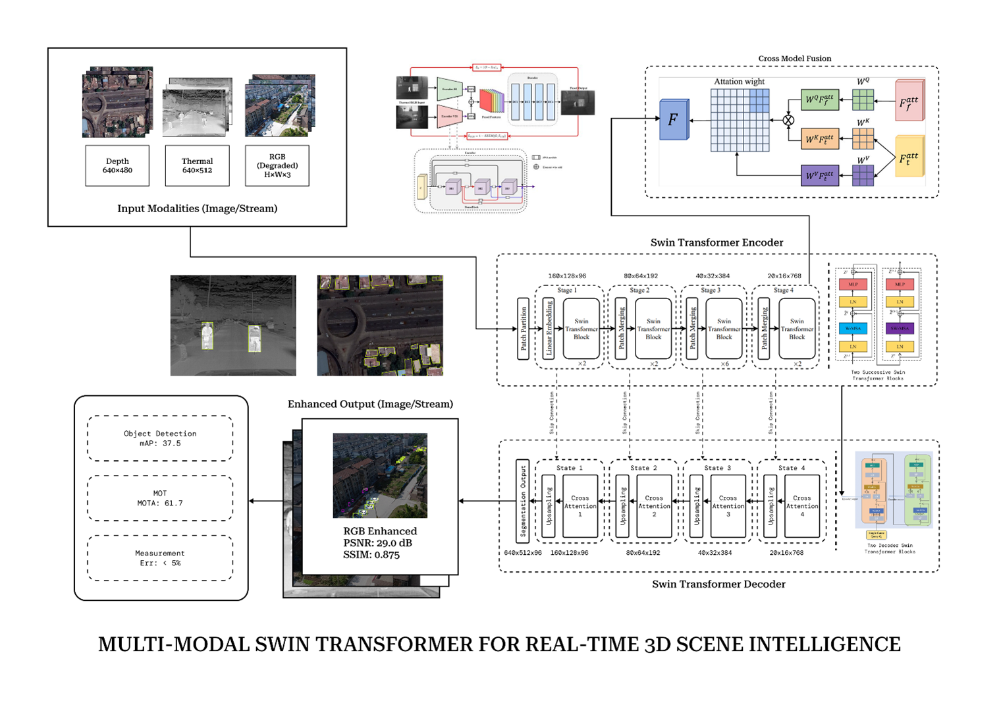

# ReconMMT

**ReconMMT** stands for **Reconstruction using a Multi-Model Transformer for Real-Time Geospatial Scene Understanding and Sensing**.

This repository contains the research implementation and supporting assets for ReconMMT, a multi-model aerial perception framework designed for unmanned aerial vehicle (UAV) operations in visually degraded environments.

The proposed framework integrates synchronized **RGB, thermal, and depth data** to reconstruct enhanced visual representations and support downstream geospatial perception tasks, including object analysis, tracking, and metric scene interpretation.

<div align="center">



</div>

## Overview

Reliable aerial perception remains challenging under adverse environmental conditions, including low illumination, haze, fog, smoke, radiometric variations, and partial occlusion. Conventional single-model approaches can be vulnerable to these conditions, while traditional processing pipelines often treat image enhancement and scene understanding as independent tasks.

ReconMMT addresses these limitations through a unified multi-model reconstruction architecture that combines model-specific feature extraction, cross-model feature fusion, and transformer-based contextual reasoning.

By leveraging complementary information from RGB, thermal, and depth sensors, the framework aims to reconstruct structurally consistent, visually enhanced scene representations suitable for robust aerial perception.

The repository provides a research-oriented implementation supporting model development, training, evaluation, inference, checkpoint management, and ONNX export.

Experimental applications under `apps/web` and `apps/api` are maintained separately from the core research implementation.

## Research Contributions

The primary contributions of ReconMMT include:

- **Multi-model reconstruction:** A unified framework integrating synchronized RGB, thermal, and depth observations for enhanced aerial scene reconstruction.
- **Cross-model feature fusion:** A transformer-based fusion architecture designed to capture complementary spatial, structural, and contextual information across sensing streams.
- **Context-aware reconstruction:** Hierarchical feature extraction and transformer-based reasoning to improve reconstruction under visually degraded conditions.
- **Synchronized data augmentation:** Spatially consistent augmentation across sensing inputs, combined with degradation-aware RGB transformations.
- **End-to-end research workflow:** An implementation supporting training, evaluation, checkpointing, inference, and ONNX model export.

## Model Architecture

ReconMMT follows a four-stage reconstruction pipeline.

1. **Model-Specific Encoding:** Dedicated encoders extract hierarchical features from RGB, thermal, and depth inputs.
2. **Cross-Model Feature Fusion:** Features from individual encoding branches are integrated to exploit complementary visual, thermal, and geometric information.
3. **Transformer Bottleneck:** Transformer-based contextual reasoning captures high-level dependencies across fused feature representations.
4. **Hierarchical Decoding:** A reconstruction decoder progressively restores spatial information to generate an enhanced RGB output.

The architecture incorporates synchronized augmentation to preserve spatial correspondence between sensor observations during training.

## Repository Structure

```text
.
├── main.py
├── train.py
├── test.py
├── models/
│   └── algo.py
├── data/
├── results/
├── visualization/
│   └── architecture.png
├── .docs/
├── apps/
│   ├── web/
│   └── api/
└── Makefile
```

### Key Components

| Component | Description |
|---|---|
| `main.py` | Unified entry point for smoke testing, inference, model export, and training/evaluation delegation. |
| `train.py` | Model training and checkpoint management. |
| `test.py` | Model evaluation on validation and test datasets. |
| `models/algo.py` | Model architecture, dataset handling, augmentation, loss functions, evaluation metrics, and export utilities. |
| `.docs/` | Supporting research documentation, reports, and manuscript materials. |
| `apps/` | Experimental web and API applications. |

## Dataset Organization

ReconMMT expects spatially aligned samples with matching filenames across RGB, thermal, depth, and target directories.

```text
data/
├── train/
│   ├── rgb/
│   ├── thermal/
│   ├── depth/
│   └── target/
├── val/
│   ├── rgb/
│   ├── thermal/
│   ├── depth/
│   └── target/
└── test/
    ├── rgb/
    ├── thermal/
    ├── depth/
    └── target/
```

### Example Sample

```text
data/train/rgb/frame_001.png
data/train/thermal/frame_001.png
data/train/depth/frame_001.png
data/train/target/frame_001.png
```

Each sample must maintain correspondence across all input streams and its reconstruction target.

## Installation

**Requirements:** Python 3.10 or newer.

Install the core dependencies:

```bash
python -m pip install --upgrade pip
python -m pip install torch torchvision pillow onnx
```

Alternatively, use the provided Makefile target:

```bash
make install
```

For additional configuration instructions, refer to [INSTALL](./INSTALL).

## Usage

### 1. Compile Check

Validate Python source compilation:

```bash
make compile
```

### 2. Smoke Test

Run a basic model validation:

```bash
make smoke
```

### 3. Model Training

Train ReconMMT using the configured dataset:

```bash
make train DATA_ROOT=data IMAGE_SIZE=256 BATCH_SIZE=4 EPOCHS=30 OUTPUT_DIR=results/reconmmt
```

### 4. Model Evaluation

Evaluate a trained checkpoint:

```bash
make test DATA_ROOT=data CHECKPOINT=results/reconmmt/best_reconmmt.pt IMAGE_SIZE=256 BATCH_SIZE=4
```

### 5. Single-Sample Inference

Generate an enhanced RGB reconstruction from synchronized sensor inputs:

```bash
make infer \
  CHECKPOINT=results/reconmmt/best_reconmmt.pt \
  RGB=data/test/rgb/frame_001.png \
  THERMAL=data/test/thermal/frame_001.png \
  DEPTH=data/test/depth/frame_001.png \
  OUTPUT=results/reconmmt/infer_frame_001.png
```

### 6. ONNX Export

Export a trained model to ONNX format:

```bash
make export CHECKPOINT=results/reconmmt/best_reconmmt.pt OUTPUT_DIR=results/reconmmt
```

## Training and Evaluation

The implementation focuses on reconstruction-oriented learning using synchronized observations from multiple sensing streams.

**Training characteristics:**

- Joint processing of RGB, thermal, and depth inputs.
- Spatially synchronized data augmentation.
- Degradation-aware RGB transformations.
- Reconstruction-based optimization.
- Model checkpointing for experiment reproducibility.

**Evaluation metrics:**

| Metric | Description |
|---|---|
| Reconstruction Loss | Measures the model's reconstruction objective. |
| PSNR | Peak Signal-to-Noise Ratio; measures reconstruction fidelity. |
| SSIM | Structural Similarity Index Measure; evaluates structural similarity. |
| MAE | Mean Absolute Error; measures average pixel-level reconstruction error. |

These metrics provide quantitative measures of reconstruction quality. Downstream perception performance requires separate task-specific evaluation.

## Implementation Notes

- The core research implementation is centered on the `ReconMMT` architecture and its reconstruction objective.
- RGB, thermal, and depth inputs must maintain spatial correspondence throughout preprocessing and training.
- Synchronized augmentation preserves alignment across sensor inputs and target representations.
- The model generates an enhanced RGB reconstruction intended for subsequent aerial perception tasks.
- Experimental applications in `apps/web` and `apps/api` are maintained independently of the primary research workflow.

## Research Documentation

Supporting research materials, architectural references, and manuscript resources are maintained in the [`.docs/`](./.docs/) directory.

The repository serves as the implementation reference for the ReconMMT research project.

## Citation

If you use ReconMMT in academic research or related projects, cite the associated research publication or technical report when its finalized bibliographic details become available.

**Project title:**

```text
ReconMMT: Reconstruction using a Multi-Model Transformer for Real-Time Geospatial Scene Understanding and Sensing
```

## Copyright and License

Copyright © Gautam Ankoji.

This project is licensed under the **MIT License**. See [LICENSE](./LICENSE) for details.
